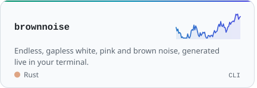
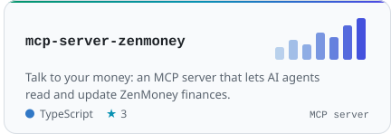
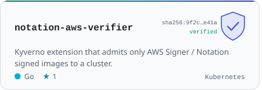
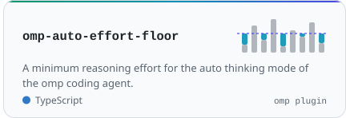
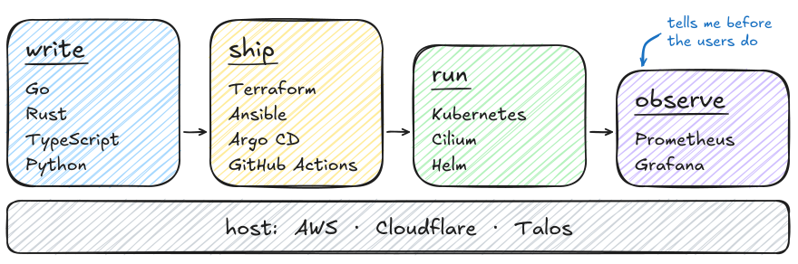
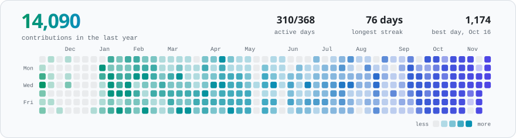

  <picture>
    <source media="(prefers-color-scheme: dark)" srcset="assets/hero-dark.svg">
    
  </picture>
  

    <a href="https://bulatov.dev">bulatov.dev</a>
    &nbsp;·&nbsp;
    <a href="https://www.linkedin.com/in/asanali-bulatov/">LinkedIn</a>
    &nbsp;·&nbsp;
    <a href="https://t.me/krax1337">Telegram</a>
    &nbsp;·&nbsp;
    <a href="mailto:asanali.bulatov@gmail.com">Email</a>
  

I run Kubernetes platforms and the delivery pipelines around them. Currently at [Higgsfield AI](https://higgsfield.ai), on GPU clusters for AI workloads; before that, payment systems for banks. On the side I write small tools and release them the way I want production software shipped: signed, with build provenance and an SBOM.

<a href="https://github.com/krax1337/brownnoise"><picture><source media="(prefers-color-scheme: dark)" srcset="assets/card-brownnoise-dark.svg"></picture></a><a href="https://github.com/krax1337/mcp-server-zenmoney"><picture><source media="(prefers-color-scheme: dark)" srcset="assets/card-mcp-server-zenmoney-dark.svg"></picture></a>
<a href="https://github.com/krax1337/notation-aws-verifier"><picture><source media="(prefers-color-scheme: dark)" srcset="assets/card-notation-aws-verifier-dark.svg"></picture></a><a href="https://github.com/krax1337/omp-auto-effort-floor"><picture><source media="(prefers-color-scheme: dark)" srcset="assets/card-omp-auto-effort-floor-dark.svg"></picture></a>

### Upstream

- [ohmyzsh/ohmyzsh](https://github.com/ohmyzsh/ohmyzsh/pull/14126): keep completion temp files out of `$fpath`
- [pglombardo/PasswordPusher](https://github.com/pglombardo/PasswordPusher/pull/4245): point the Helm chart at the `stable` image tag
- [avarayr/shamelectron](https://github.com/avarayr/shamelectron/pull/102): track RedisInsight
- [nirmata/kyverno-notation-aws](https://github.com/nirmata/kyverno-notation-aws): picked up maintenance as [notation-aws-verifier](https://github.com/krax1337/notation-aws-verifier)

### Toolbox

<picture>
  <source media="(prefers-color-scheme: dark)" srcset="assets/stack-dark.svg">
  
</picture>

### Last 12 months

<picture>
  <source media="(prefers-color-scheme: dark)" srcset="assets/activity-dark.svg">
  
</picture>

  Artwork is drawn by <a href="scripts/build.py">scripts/build.py</a> and refreshed daily by <a href=".github/workflows/build.yml">a workflow</a>.

