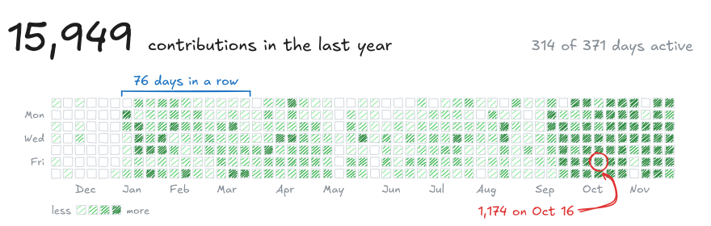

<picture>
  <source media="(prefers-color-scheme: dark)" srcset="assets/hero-dark.svg">
  
</picture>

[bulatov.dev](https://bulatov.dev) · [LinkedIn](https://www.linkedin.com/in/asanali-bulatov/) · [Telegram](https://t.me/krax1337) · [Email](mailto:asanali.bulatov@gmail.com)

I run Kubernetes platforms and the delivery pipelines around them. Currently at [Higgsfield AI](https://higgsfield.ai), on GPU clusters for AI workloads; before that, payment systems for banks. On the side I write small tools and release them the way I want production software shipped: signed, with build provenance and an SBOM.

<h3><picture><source media="(prefers-color-scheme: dark)" srcset="assets/title-upstream-dark.svg"></picture></h3>

- [ohmyzsh/ohmyzsh](https://github.com/ohmyzsh/ohmyzsh/pull/14126): keep completion temp files out of `$fpath`
- [pglombardo/PasswordPusher](https://github.com/pglombardo/PasswordPusher/pull/4245): point the Helm chart at the `stable` image tag
- [avarayr/shamelectron](https://github.com/avarayr/shamelectron/pull/102): track RedisInsight
- [nirmata/kyverno-notation-aws](https://github.com/nirmata/kyverno-notation-aws): picked up maintenance as [notation-aws-verifier](https://github.com/krax1337/notation-aws-verifier)

<h3><picture><source media="(prefers-color-scheme: dark)" srcset="assets/title-stack-dark.svg"></picture></h3>

<picture>
  <source media="(prefers-color-scheme: dark)" srcset="assets/stack-dark.svg">
  
</picture>

<h3><picture><source media="(prefers-color-scheme: dark)" srcset="assets/title-year-dark.svg"></picture></h3>

<picture>
  <source media="(prefers-color-scheme: dark)" srcset="assets/year-dark.svg">
  
</picture>

Every sketch is drawn by <a href="scripts/build.py">a script</a> and redrawn daily by <a href=".github/workflows/build.yml">a workflow</a>. Lettering: Excalifont, <a href="scripts/OFL.txt">OFL</a>.
